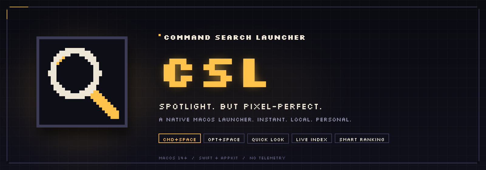
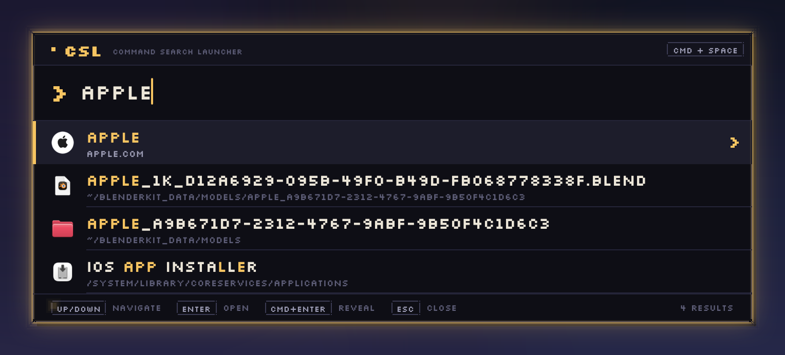
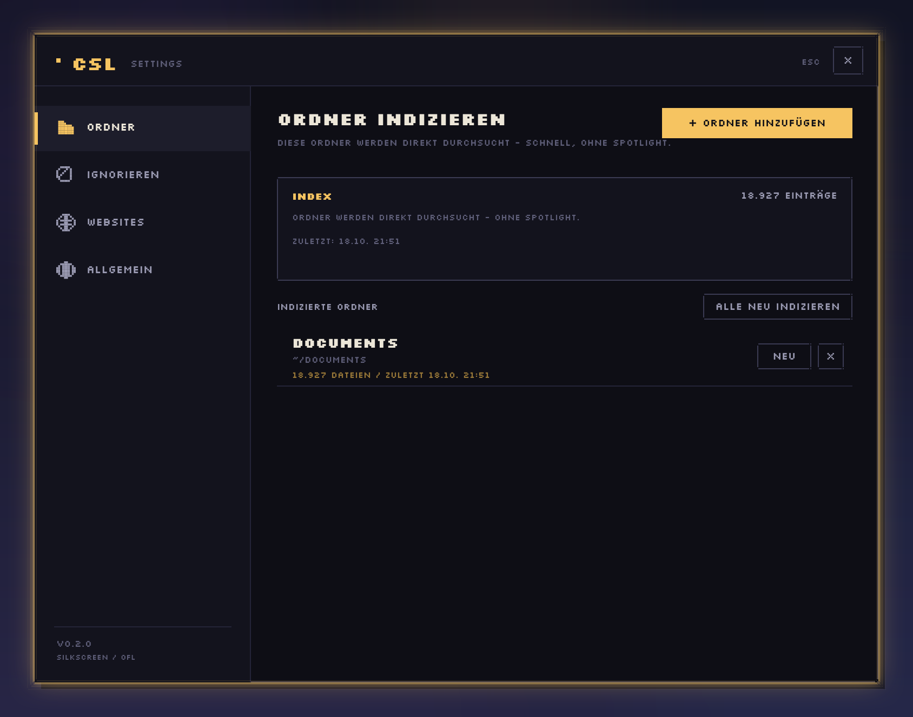
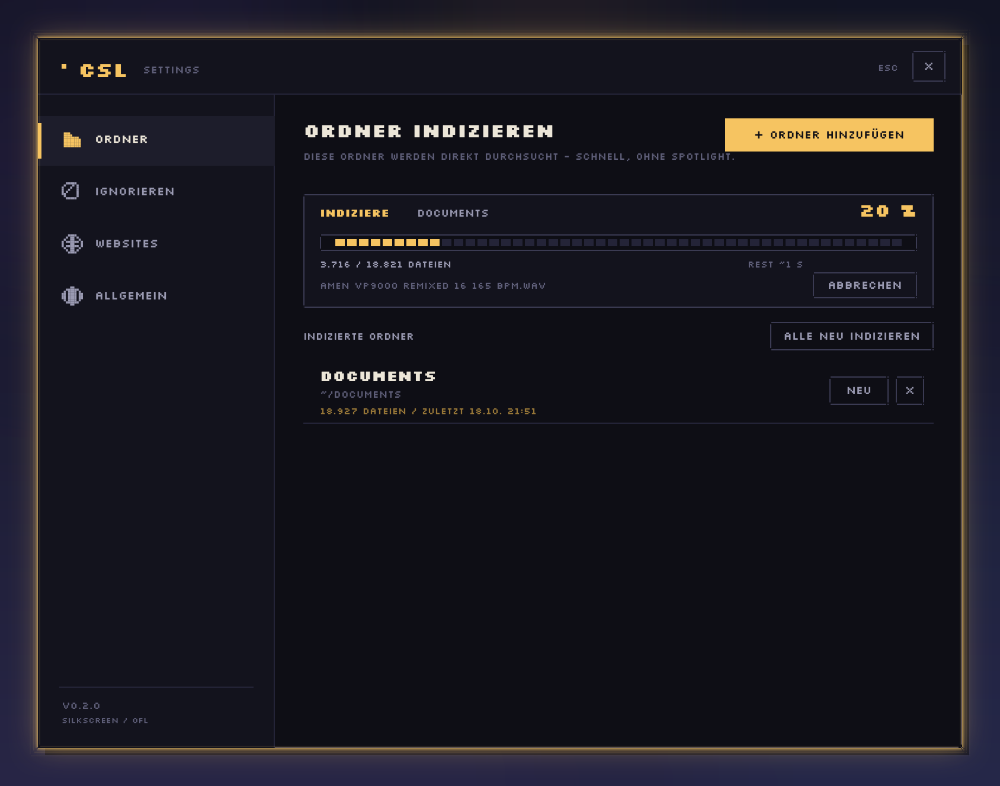
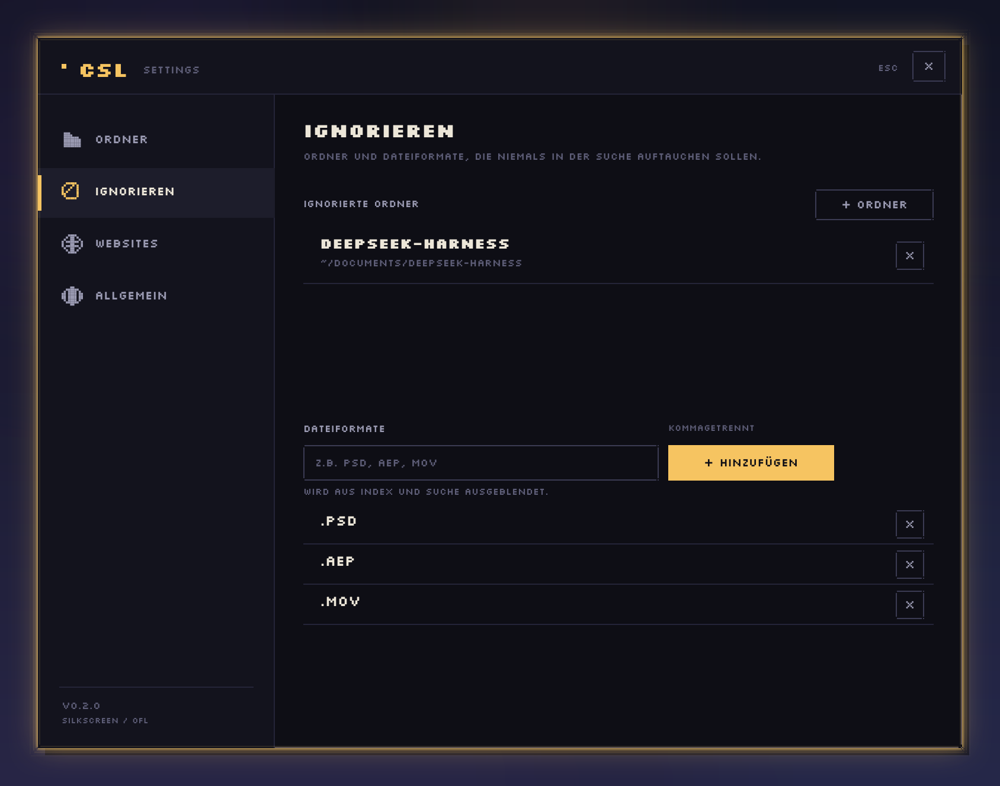
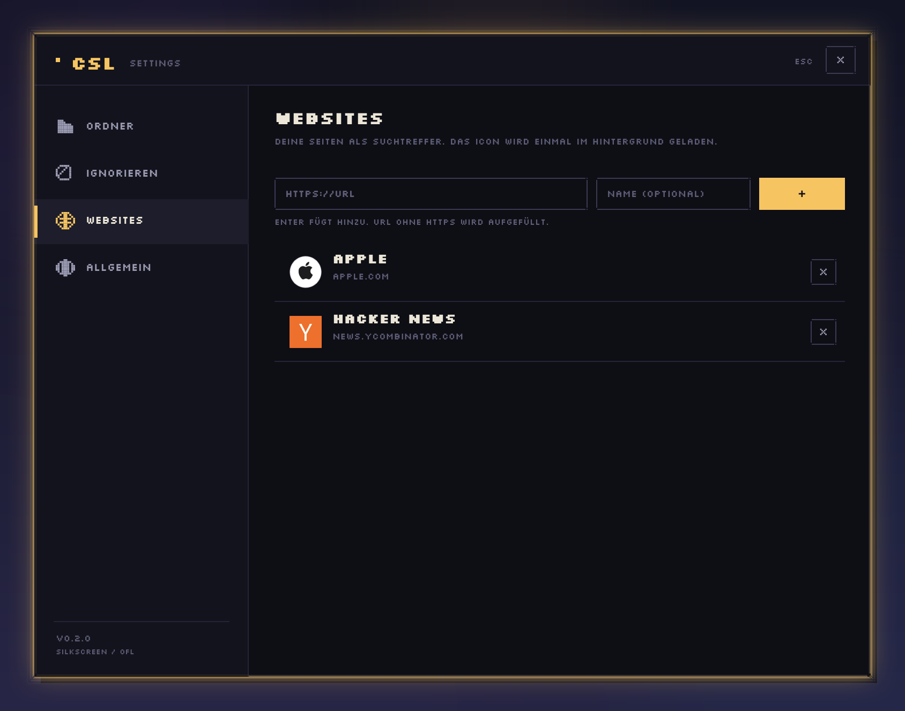

<p align="center">
  
</p>

<h1 align="center">CSL — Command Search Launcher</h1>

<p align="center">
  <strong>Spotlight, but pixel-perfect.</strong><br>
  A native macOS launcher: instant search, Quick Look, a live FSEvents index,<br>
  local learning-to-rank, and a UI that scales from tiny to huge.
</p>

<p align="center">
  <a href="https://github.com/SirCartaux/csl/releases/latest">
    
  </a>
  
  
  
  
</p>

<p align="center">
  <a href="#download">Download</a> ·
  <a href="#features">Features</a> ·
  <a href="#usage">Usage</a> ·
  <a href="#settings">Settings</a> ·
  <a href="#smart-ranking">Ranking</a> ·
  <a href="#performance">Performance</a> ·
  <a href="#architecture">Architecture</a> ·
  <a href="#license">License</a>
</p>

<p align="center">
  
</p>

> The screenshots show the German UI. Search understands both German and English
> keywords. The repository documentation is English-only; GitHub has no
> per-language README routing.

---

## Why Swift (and not Electron, Tauri or Python)?

| | |
|---|---|
| **Swift + AppKit** | No runtime overhead. The panel appears in ~30 ms and app hits land in ~1–3 ms. The Carbon hotkey needs **no** Accessibility permission. `NSMetadataQuery` reuses the Spotlight index. |
| Electron | ~100 MB of runtime, cold start above one second, and focus/panel behaviour needs workarounds. The wrong tool for a launcher. |
| Tauri | Smaller, but the WebView boot and focus handling remain noticeable; a native `NSPanel` is more precise. |
| Python + PyObjC | Quick to prototype, but startup, signing and concurrency become painful. |

SwiftUI would work, but a borderless hotkey panel with exact control over key
window, field editor and focus is more direct in AppKit.

---

## Features

- **Global hotkeys:** `⌘Space` with an `⌥Space` fallback — no Accessibility permission.
- **Instant:** pre-warmed panel, visible in ~25–35 ms, search field focused immediately.
- **Resizable and scalable:** drag the glowing panel edge or any corner. Every row, font, icon, border and the glow scales with it. The panel stays centered and remembers its scale.
- **Fast sources:** apps, websites and commands are instantaneous; indexed folders answer in milliseconds; Spotlight files stream in (prefix ~30–100 ms, substring ~300 ms).
- **Quick Look:** press `Space` on a file result after mouse selection, `Tab` or arrows. `Space`/`Esc` closes it; typing jumps back into the query.
- **Native actions:** single click selects, double click or `Enter` opens, `⌘Enter` reveals in Finder, right click for Open / Show in Finder / Copy Path, drag files and URLs out of the launcher.
- **Live index:** FSEvents keeps indexed folders current — new, changed, renamed and deleted files show up in about a second, with catch-up after a restart.
- **Smart local ranking:** match tiers, frequency, recency, query affinity, time of day and working-folder context. Commands are never boosted by usage.
- **Real settings window** (search `CSL SETTINGS`, or use the menu bar): index folders with progress, percentage and ETA; ignore folders and extensions; add websites with automatically fetched favicons.
- **Menu bar item:** open, settings, launch at login, keyboard shortcuts, quit.
- **Pixel UI:** Silkscreen, hard edges, notched corners, hard shadows and an animated amber glow at 0% idle CPU.
- **Reveal animation:** fixed-size pixels pop in without a cross-fade — opening spreads from the search bar and closing removes pixels from the outside in. New result rows slide in smoothly from the side with a Gaussian-blurred snapshot that crossfades into the sharp row. GPU-composited, pre-warmed, zero cost to the search path; speed is adjustable in **Settings → Animation** (0,25×–2,0×, default 1,00×).
- **German and English search keywords** (`papierkorb`, `einstellungen`, `settings`, …).

---

## Download

[**Get the latest version of CSL →**](https://github.com/SirCartaux/csl/releases/latest)

| | |
|---|---|
| **DMG** | `CSL-0.3.0.dmg` — open it and drag CSL into `/Applications` |
| **ZIP** | `CSL-0.3.0.zip` — unzip and move `CSL.app` to `/Applications` |
| **Requirements** | macOS 14 Sonoma or newer · Universal binary (Apple Silicon + Intel) |
| **Price** | Free, Public Domain (Unlicense), no telemetry |

CSL is **ad-hoc signed and not notarized**. On first launch, **right-click CSL.app → Open**
(or run `xattr -dr com.apple.quarantine /Applications/CSL.app` once). After that it
starts normally.

> **Important:** `⌘Space` is still owned by Spotlight by default. Either disable
> Spotlight (see below) or use `⌥Space` right away.

---

## Build from source

Requirements: macOS 14+, Xcode Command Line Tools and Swift 6.x.

```bash
git clone https://github.com/SirCartaux/csl.git
cd csl

./scripts/build.sh release   # builds build/CSL.app
open build/CSL.app           # starts in the menu bar

# or with live logs in the terminal:
./scripts/dev.sh
```

For everyday use, move `build/CSL.app` to `/Applications`. There is no Xcode
project — SwiftPM plus the scripts in `scripts/` are enough.

---

## The `⌘Space` problem

macOS reserves `⌘Space` for Spotlight. Disable it once:

> **System Settings → Keyboard → Keyboard Shortcuts… → Spotlight →
> uncheck “Show Spotlight search”**

Until then, **`⌥Space`** works immediately. The CSL menu bar item shows a warning
while the Spotlight shortcut is still active and opens the right settings page
when clicked.

---

## Usage

| Input | Action |
|---|---|
| `⌘Space` / `⌥Space` | Open / close the panel |
| Type | Search (apps and websites instantly, index files in ~5–40 ms, Spotlight streams in) |
| `↑` / `↓` | Move selection |
| `Tab` / `⇧Tab` | Select the first result, then move the selection |
| `Enter` | Open the selection (always, including after mouse selection) |
| `⌘Enter` | Reveal in Finder |
| `Space` | Quick Look for a file result (after mouse selection, `Tab` or arrows); press again to close; otherwise a space in the query |
| `Esc` | Close Quick Look, or close the panel |
| Click a result | Select only (does not open) |
| Double-click a result | Open |
| Right-click a result | Open, Show in Finder, Copy Path/URL |
| Drag a result out | Drag files/apps/URLs into Finder or other apps (copy) |
| **Drag the glowing panel edge/corner** | **Scale the whole launcher; the panel stays centered** |
| Click outside | Close |

Changing the query (letter, Backspace, paste) switches `Space` back to a literal
space. Typing while Quick Look is open closes the preview and feeds the character
into the query.

With an empty query, the quick commands appear (Sleep, Empty Trash, Screenshot,
System Settings, Applications, Quit).

### Reaching the settings

Type **`csl`**, **`settings`** or **`einstellungen`** and choose **CSL SETTINGS**.
The result is intentionally not always at the top: system settings and apps stay
ahead of it, and it is hidden from the empty quick list. Alternatively:
menu bar → **EINSTELLUNGEN…**.

---

## Settings



### Index folders



- **+ ADD FOLDER** opens the system picker; indexing starts immediately.
- Progress: **progress bar**, **exact percentage**, **processed/total files**,
  **current file** and an **estimated remaining time** based on throughput.
- Phase 1 **SCANNING** counts files (total unknown), phase 2 **INDEXING** has the
  exact total and therefore percentage + ETA.
- **CANCEL** discards the run; existing index data stays untouched.
- Per folder: **NEW** (reindex) and **X** (remove); at the top: **REINDEX ALL**.
- On the next launch, missing indexes are rebuilt in the background.

For these folders CSL searches its in-memory index **before** Spotlight. The index
is stored as JSON and loaded asynchronously at launch. Limit: 300,000 entries per
run; default exclusions below.

### Ignore



- **Ignore folders:** add them with the picker; they are skipped during indexing
  and filtered out of results.
- **Ignore file extensions:** enter e.g. `psd, aep, mov`, press Enter or **+ ADD**.
  Applies to the custom index **and** to Spotlight results.
- Hidden by default (even without an entry): `node_modules`, `.git`, `build`,
  `DerivedData`, `index.noindex`, `Caches`, `Library`, `.Trash`, `target`,
  `cmake-build-*`, `.cache`, `.next`, `Pods`, venvs.

### Websites



- Enter a URL (no `https://` needed), optionally a name, then Enter or **+**.
- The icon is fetched **once in the background** (apple-touch-icon → favicon.ico →
  HTML `<link rel="icon">`), scaled to at most 64 px and cached as PNG.
- Websites appear instantly in search with the fetched icon.
- If fetching fails: globe placeholder, **NO ICON FOUND** hint, and an **ICON**
  button for a retry.

### Animation

A speed slider from **0,25× (slow)** to **2,0× (fast)**, default **1,00×**.
It changes the open/close pixel wave and the smooth new-row slide without
touching search performance. The launcher pixels still jump hard from 0 to 100 %;
result rows get the Gaussian-blur slide instead of a pixel reveal.

### General

Hotkey overview, Spotlight hint with a direct link to Keyboard Shortcuts,
**Launch at Login**, the data folder in Finder, index stats, **reset ranking
statistics**, and the version.

---

## Performance (measured on this Mac, macOS 26.5)

| Step | Time |
|---|---|
| Hotkey → panel visible | ~25–35 ms |
| App / website / command hits after a keypress | ~1–3 ms |
| Index hits (async, 27,000 entries) | ~25–40 ms (main thread stays free) |
| First Spotlight file hits (prefix) | ~30–100 ms |
| Additional substring hits | ~280–330 ms (after a 110 ms typing pause) |
| App index at launch (195 apps) | ~70–220 ms |
| Folder indexing | ~20,000 objects/s scan; 18,900 files ≈ 1 s + index <1 s |
| Glow at idle | 0% CPU (GPU/layer animation) |
| FSEvents watcher at idle | 0% CPU (no polling, one stream per folder) |
| Ranking per keypress | < 1 ms (only the ~32 candidates, no I/O) |

Synchronous results (apps, websites, index) are emitted immediately; the index
search runs off-main with cancellation; Spotlight is queried in two stages
(prefix immediately, substring after a short pause). **No process** is started per
search.

---

## Live index & FSEvents

- **Indexed folders** are watched with **FSEvents**. New, changed, renamed and
  deleted files land in the index after ~1 s — the next search sees them.
- **At launch**, stored event IDs replay changes that happened while CSL was not
  running. If the history is too old, macOS requests `MustScanSubDirs` and CSL
  reindexes the folder once.
- **Everything outside** indexed folders still comes live from the Spotlight
  index; no extra background process.
- **Resources:** one coalesced FSEvents stream per folder, 0.8 s latency,
  off-main processing, only changed paths. The index is written no earlier than
  2.5 s after the last change and only when dirty. Directory renames scan only the
  new subtree; lost events trigger a single reindex run. No polling, no permanent
  full-disk scan.

---

## Smart ranking

The order is built in layers:

1. **Match quality:** exact > prefix > word boundary > substring > fuzzy.
   Duplicate exact titles (for example six folders named “Settings”) lose weight.
   A whole-word hit inside an app name (“code” → Visual Studio Code) counts like a
   prefix, so noisy files such as `CodeResources` do not outrank the app.
2. **Learning from use:** opening, revealing and dragging out count. Frequency
   (log-damped), last use (seven-day half-life), recently opened results, query
   affinity (title and query tokens), time of day/weekday, and the last working
   folder (sibling files get a small boost).
3. **Intent:** file extensions and paths favour files, URL-like queries favour
   websites, apps keep a slight type bonus. Exact matches stay ahead of
   prefix/substring matches.
4. **Safety:** commands are **never** boosted by usage. A frequently used SLEEP,
   QUIT or CSL SETTINGS cannot sneak to the top; CSL SETTINGS stays below SYSTEM
   SETTINGS.

Everything stays local in `ranking.json`; there is no cloud and no telemetry.
Reset it under **Settings → General → RESET RANKING STATISTICS** (or delete
`ranking.json`).

---

## Data & storage

Everything lives under:

```
~/Library/Application Support/CSL/
├── settings.json    # folders, ignore lists, websites, launcher scale
├── index.json       # file index (name, path, extension, root)
├── ranking.json     # local learning data (frequency, recency, tokens)
└── icons/           # cached website icons (PNG)
```

For tests and demos, point `CSL_DATA_DIR` at a scratch directory.

---

## Architecture

```
Sources/CSL/
  App/          AppDelegate (window, hotkey, menu, debug modes), main.swift
  Core/         SearchResult, FuzzyMatcher, SettingsStore, AppPaths,
                SearchExclusions
  Hotkey/       HotkeyManager (Carbon, ⌘Space + ⌥Space)
  Search/       AppProvider, FileProvider, CommandProvider, WebsiteProvider,
                FileIndex, FolderIndexer, IndexCoordinator, FaviconService,
                SearchEngine, ResultRanker
  Settings/     SettingsWindow(Controller), RootView, Sidebar, Sections,
                Pixel controls (button, field, progress bar, lists)
  UI/           Launcher: SearchPanel, SearchViewController, ResizeHandleView,
                RootView, GlowView, ResultRowView, PixelTextField, Theme,
                PixelFont, PixelDraw, Glyph
  Support/      Log
Resources/      Info.plist, Fonts/Silkscreen (OFL), CSL.icns
Tools/          make_icon.py (pixel app icon)
scripts/        build.sh, dev.sh, run.sh
docs/           preview and settings screenshots
```

### Design

- **Palette and metrics:** `Sources/CSL/UI/Theme.swift`
- **Font:** Silkscreen (SIL Open Font License), bundled.
- **Scaling:** `ResizeHandleView` drives `Theme.launcherScale`; layout metrics,
  fonts, icons, borders and glow all derive from it. The Settings window keeps
  its own fixed size.
- **Glow:** `GlowView` sits above the window, draws pixel rings plus a soft
  CG shadow, and animates layer opacity with `CABasicAnimation` (1.75 s per
  direction). Both windows share the component.
- **Hard edges only:** no rounded corners, no blur except the intentional glow,
  1 px borders, notched corners, hard offset shadows.
- **Icons:** real app/file icons, website favicons, and hand-drawn 10×10 pixel
  glyphs for system commands.

---

## Debug & tests

```bash
# Open the panel directly
./build/CSL.app/Contents/MacOS/CSL --show

# Open settings on a specific tab
./build/CSL.app/Contents/MacOS/CSL --settings --tab websites

# Render UI to PNG (no Screen Recording permission needed)
./build/CSL.app/Contents/MacOS/CSL --snapshot /tmp/csl.png --query "notes"
./build/CSL.app/Contents/MacOS/CSL --snapshot /tmp/csl-big.png --query "notes" --scale 1.6
./build/CSL.app/Contents/MacOS/CSL --settings-snapshot /tmp/settings.png --tab folders

# Search logic + latency on stdout
./build/CSL.app/Contents/MacOS/CSL --selftest "safari"

# Several queries in sequence
./build/CSL.app/Contents/MacOS/CSL --bench "safari,documents,notes"

# Index a folder / test favicon fetching (separate data directory)
CSL_DATA_DIR=/tmp/csl-test ./build/CSL.app/Contents/MacOS/CSL --index-folder ~/Documents
CSL_DATA_DIR=/tmp/csl-test ./build/CSL.app/Contents/MacOS/CSL --fetch-icon https://www.apple.com

# Live-index test: creates, renames and deletes files
CSL_DATA_DIR=/tmp/csl-watch ./build/CSL.app/Contents/MacOS/CSL --watch-test /tmp/csl-watch-folder

# Catch-up check (file was created while CSL was not running)
CSL_DATA_DIR=/tmp/csl-watch ./build/CSL.app/Contents/MacOS/CSL --watch-check /tmp/csl-watch-folder --query resume

# Ranking formula test (synthetic hits, learns eight opens)
CSL_DATA_DIR=/tmp/csl-rank ./build/CSL.app/Contents/MacOS/CSL --rank-test

# Context menu and drag source
./build/CSL.app/Contents/MacOS/CSL --menu-test --drag-test --query "safari"

# Verbose timing logs
CSL_DEBUG=1 ./build/CSL.app/Contents/MacOS/CSL
```

---

## Roadmap

- Trigram/prefix-tree index for <10 ms searches with 100k+ entries
- Content/OCR search for indexed documents
- Ranking weights configurable in Settings
- Recents, calculator, clipboard history and web search as quick actions
- Hotkey configuration in the settings window
- Signing, notarization, auto-update and a clean login-item distribution

## Known limitations

- The Spotlight index must be enabled (System Settings → Spotlight).
- The custom index knows file names, not contents (full-text/OCR is still open).
- Files outside indexed folders appear only after Spotlight has indexed them; the
  live FSEvents index covers only the folders you choose.
- FSEvents targets local volumes; network volumes do not deliver reliable
  filesystem events (Spotlight still applies there).
- Ranking learns only from actions inside CSL; opening a file in Finder or another
  app does not feed it.
- Default exclusions (build, target, node_modules, …) are deliberately aggressive;
  custom exceptions cannot be forced.
- Login item via `SMAppService` may fail with ad-hoc signing or outside
  `/Applications` — the app shows a hint.
- The `⌘Space` conflict with Spotlight must be resolved once manually.
- Favicon fetching needs network access; without it the globe placeholder stays.
- No Accessibility or Screen Recording permission is required.

## License

CSL is **Public Domain**, released under the [Unlicense](LICENSE). Anyone may copy,
modify, publish, sell or otherwise use it, without attribution.

The bundled **Silkscreen** font remains under the **SIL Open Font License 1.1**
(copyright: The Silkscreen Project Authors). The full text is in
[Resources/Fonts/OFL.txt](Resources/Fonts/OFL.txt).

**Credits:** Silkscreen by The Silkscreen Project Authors · app icon, pixel UI and
code by CSL Contributors · built with Swift, AppKit, Core Animation, FSEvents,
Quick Look and Spotlight.

---

## Contributing

Issues and pull requests are welcome. CSL is deliberately a small,
dependency-free SwiftPM project: no Electron runtime, no WebView, no analytics.
If you have an idea, open an issue with reproduction steps or a screenshot.

<p align="center">
  <strong>If CSL makes your day faster, leave a ⭐.</strong>
</p>
