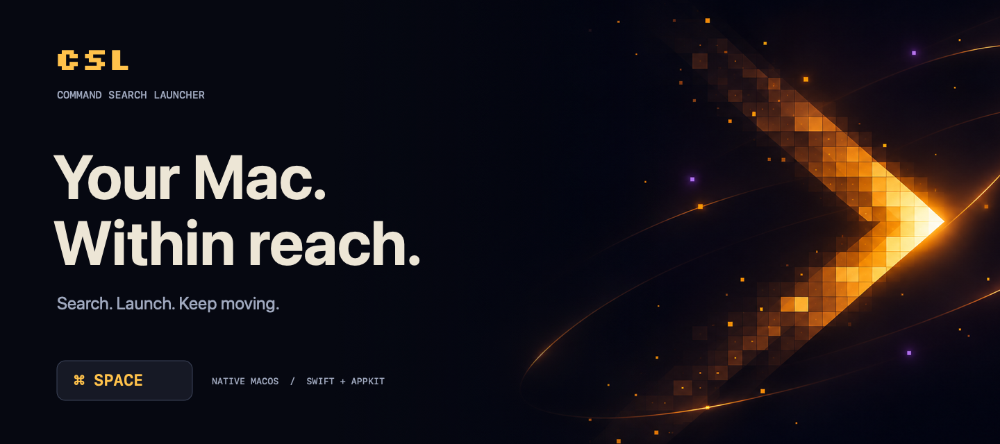
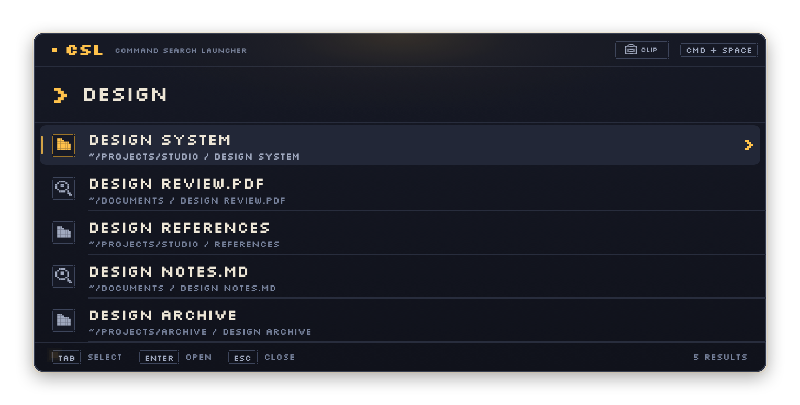
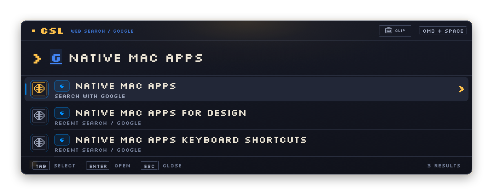
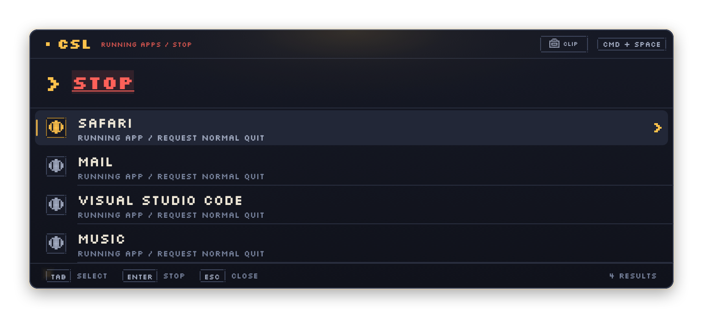
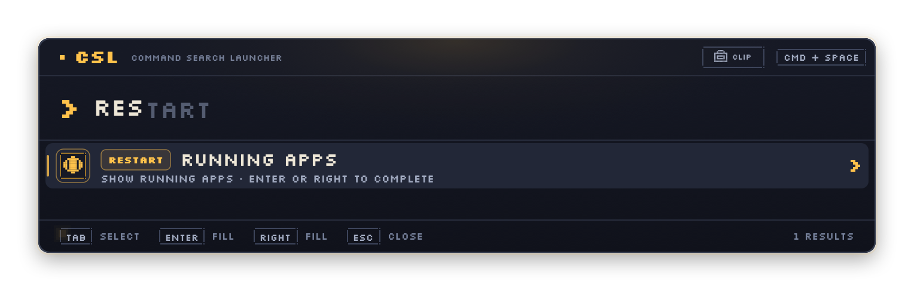
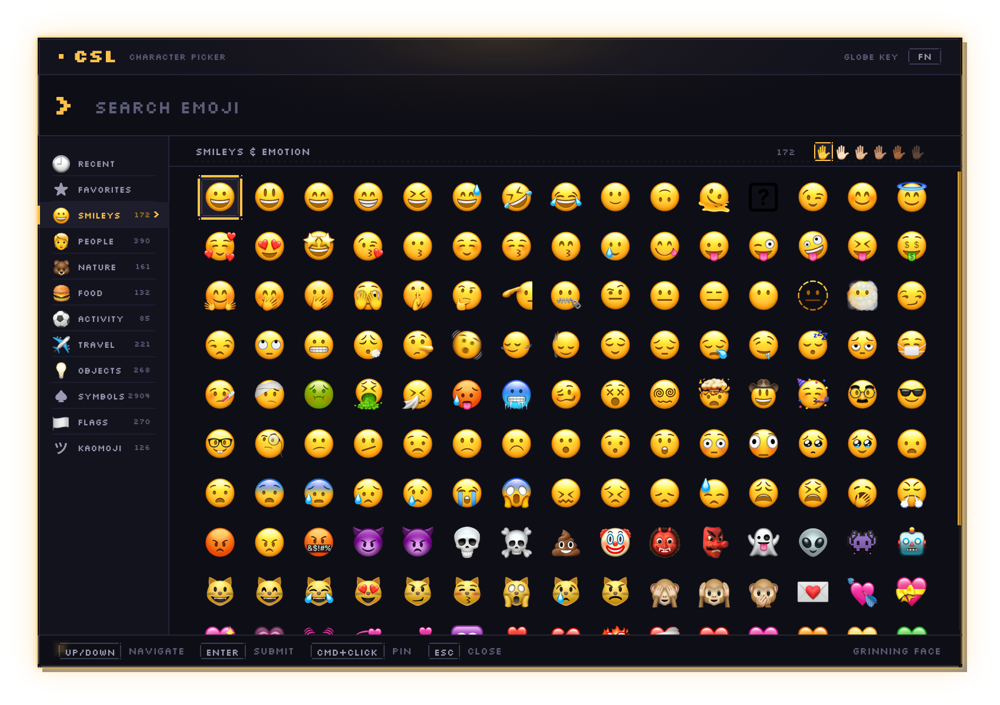
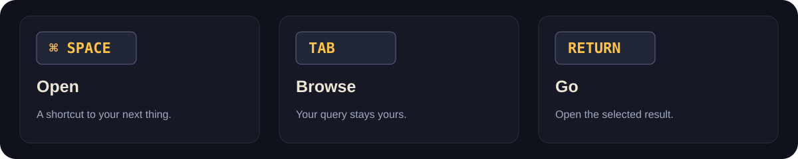
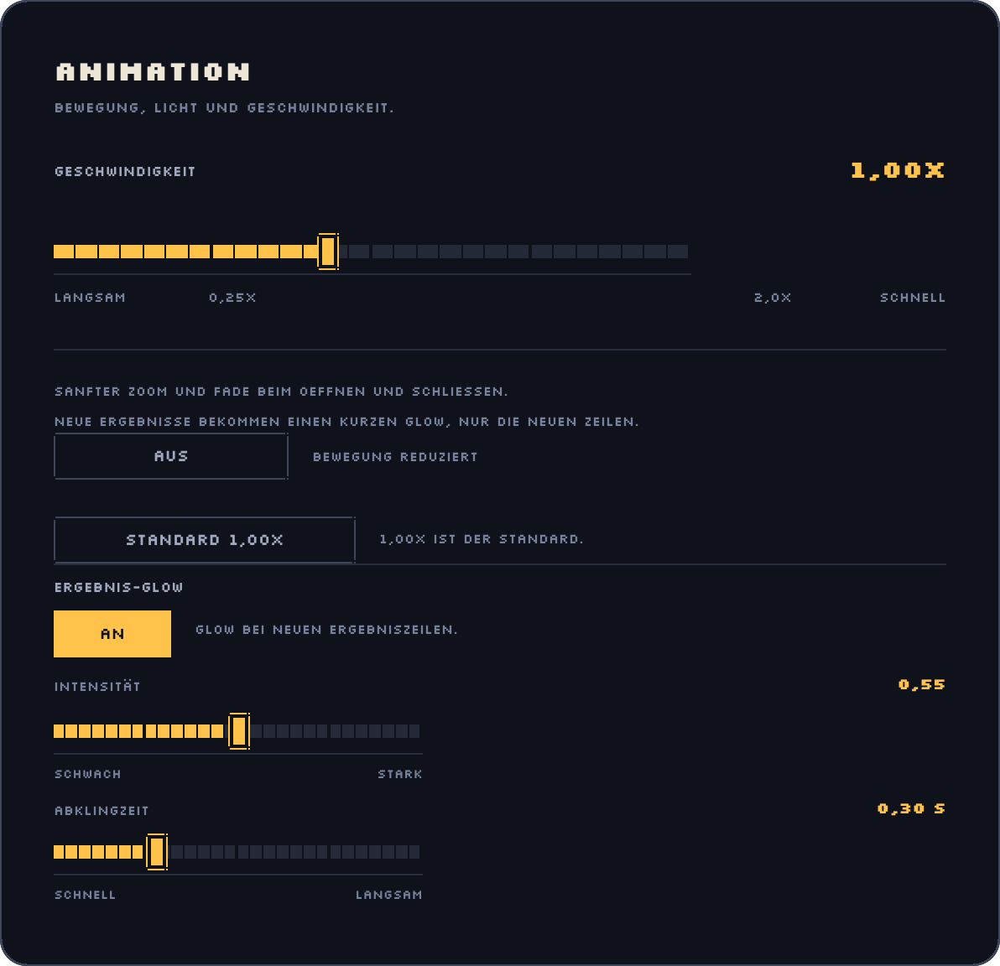
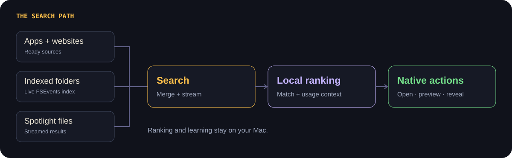

<p align="center">
  
</p>

<p align="center">
  <strong>A small window for the things you do all day.</strong><br>
  Find a file. Open an app. Search the web. Pick a character.<br>
  Keep your hands on the keyboard.
</p>

<p align="center">
  <a href="https://github.com/SirCartaux/csl/releases/latest"></a>
  
  
  <a href="LICENSE"></a>
</p>

<p align="center">
  <a href="#get-csl">Get CSL</a> &nbsp;·&nbsp;
  <a href="#one-field-many-ways-forward">Explore</a> &nbsp;·&nbsp;
  <a href="#made-for-the-keyboard">Shortcuts</a> &nbsp;·&nbsp;
  <a href="docs/GUIDE.md">User guide</a> &nbsp;·&nbsp;
  <a href="#build-it-yourself">Build</a>
</p>

<p align="center">
  
  <br><sub>Pixel lettering. Warm amber. A quieter place to find your next thing.</sub>
</p>

## Get CSL

**[Download the latest release →](https://github.com/SirCartaux/csl/releases/latest)**

Download the app ZIP from the release, unzip it, and move **CSL.app** to
**Applications**. Requires **macOS 14 Sonoma or newer**. The 0.8.1 app is universal:
Apple Silicon and Intel, in one download.

1. Open CSL. It lives in your menu bar.
2. Free up **⌘ Space** in System Settings → Keyboard → Keyboard Shortcuts → Spotlight.
3. Press **⌘ Space** and type.

<details>
<summary><strong>First launch, signing & permissions</strong></summary>

The supplied 0.8.1 app is **ad-hoc signed and not notarized**. macOS may block the
first launch; use the system's **Open Anyway** option in Privacy & Security if
shown. See the [installation guide](docs/GUIDE.md#installation) for details.

The launcher hotkey does not require Accessibility. The character picker uses
Accessibility and Input Monitoring; clipboard auto-paste also uses Accessibility.
The [guide](docs/GUIDE.md#permissions) explains each permission.

</details>

## One field. Many ways forward.

| Start with… | CSL takes it from there |
| :--- | :--- |
| An app or filename | Search apps, indexed folders and Spotlight files; preview with Quick Look. |
| `G your question` | Search the web with a configured shortcut. Add your own providers. |
| `stop` or `restart Safari` | Find running apps, request a normal quit, or wait for a quit before restarting. |
| `2+2` or `sqrt(2)` | Calculate inline and copy the answer. |
| A clipboard search | Find text, links, images and files from your clipboard history. |
| The **Fn / 🌐** key | Open the integrated character picker at the text cursor. |

### Search the web, with less repetition.



Use explicit prefixes for your favorite sites. Successful previous searches can
reappear as suggestions for the same provider. Autocomplete stays on your Mac;
typing a suggestion does not send a server request. Executing a web search opens
the provider in your browser.

### A task manager, only when you need it.



Type **`stop`** or **`restart`**, then an optional app name. CSL requests a normal
quit, so apps can ask you to save. Restart waits for the selected process to
exit before reopening its original app bundle. No force-quit. No process polling
while you are doing an ordinary search.

### Finish the thought. Keep control.



Prefix suggestions make commands easier to discover. **Tab** browses results
without rewriting your query. **Right arrow**, at the end of the field, fills a
completion. **Enter** acts on your selection. Accepting a prefix never stops or
restarts an app by itself.

### Characters, right where you are writing.



Emoji, symbols and kaomoji in the same app. Search in English or German, choose
a skin tone, pin favorites, and insert characters directly into the previously
focused app. **Fn / 🌐** opens the picker; **Esc** closes it. There is one app,
one menu-bar item, and one launch-at-login setting.

## Made for the keyboard



| Key | Action |
| :--- | :--- |
| **⌘ Space** | Open or close CSL |
| **Tab / ⇧ Tab** | Select the first result, then move forward or backward with wraparound |
| **↑ / ↓** | Move between results |
| **Enter** | Open or run the selected result, or the first result |
| **→** at the end | Fill a matching completion without running it |
| **Space** after selection | Quick Look for a file; otherwise type a space |
| **⌘ Enter** | Reveal a file in Finder |
| **⌘ ⇧ V** | Open clipboard history while CSL is open |
| **⌘ ,** | Open Settings while CSL is open |
| **Esc** | Close Quick Look or dismiss the launcher |

Mouse actions are there too: click to select, double-click to open, right-click
for actions, and drag files or URLs out. Drag the launcher edge to scale the
whole interface; CSL remembers the size.

## Your folders. Your shortcuts. Your pace.



Choose indexed folders and exclusions. Add websites, web-search prefixes and
aliases. Adjust animation speed, new-result glow, or Reduce Motion behavior.
Enable launch at login from the menu bar.

The live file index follows changes with FSEvents. Ranking learns from frequency,
recency, query affinity and working-folder context. Commands are not boosted by
usage. Search history, ranking, settings and clipboard history are stored locally.
**There is no telemetry.** Web searches and favicon fetching still use the network.

## Native, all the way down.



Swift and AppKit. A native panel, native editing, native Quick Look. No embedded
browser runtime. Fast app results, streamed files, cached first results and
background indexing keep the search field responsive.

The character picker is a separate SwiftPM target linked into the same
executable. [Explore the architecture →](docs/GUIDE.md#source-map)

## Build it yourself

macOS 14+, Xcode Command Line Tools, Swift 6.x.

```bash
git clone https://github.com/SirCartaux/csl.git
cd csl
./scripts/build.sh release universal
open build/CSL.app
```

For a native-architecture development build, use `./scripts/build.sh release`.
For live logs, use `./scripts/dev.sh`.

**[User guide](docs/GUIDE.md)** · **[Changelog](CHANGELOG.md)** ·
**[Report an issue](https://github.com/SirCartaux/csl/issues)** · **[License](LICENSE)**

---

<p align="center">
  <strong>⌘ Space. Find your next thing.</strong><br>
  <sub>Free. Public domain. Built for macOS.</sub>
</p>

<sub>Gallery: native CSL 0.8.1 AppKit views rendered with curated demo data, not
captures of personal files or running processes. UI labels may be German;
search supports German and English. Regenerate the gallery with
<code>scripts/refresh-readme-media.sh</code>. Brand artwork is decorative.</sub>
